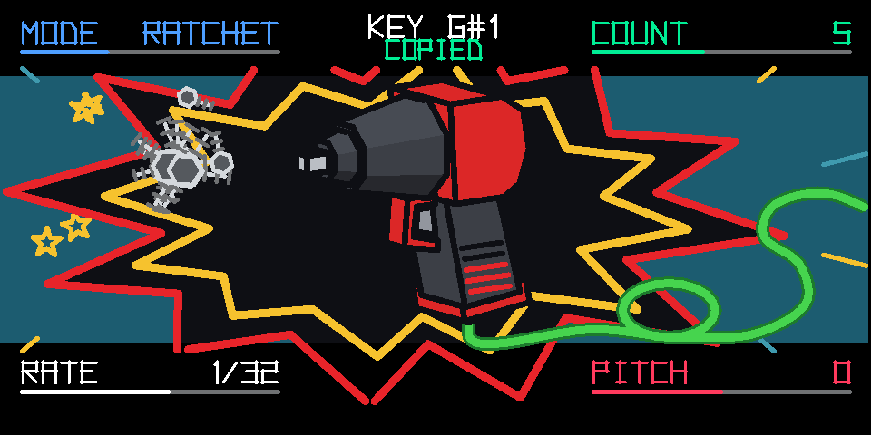
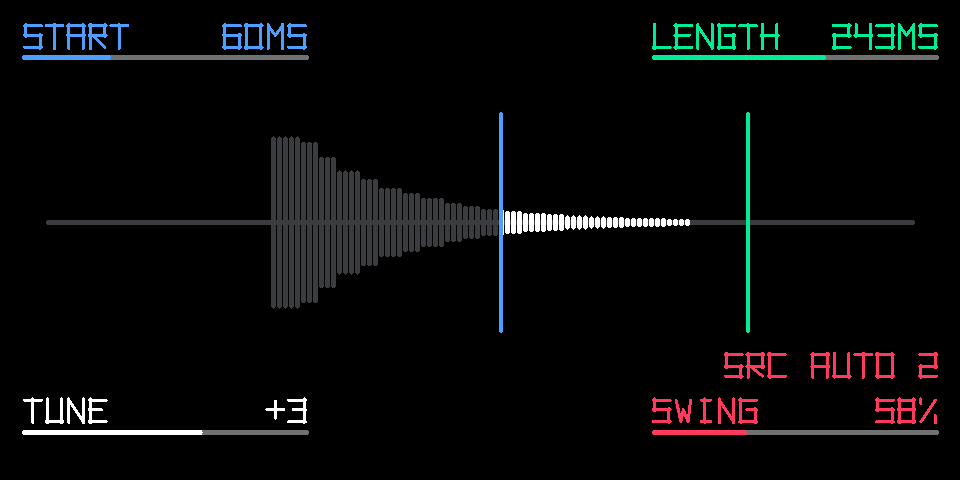

# UZ-1

A hi-hat ratchet for the original Teenage Engineering OP-1 running the
[Hundekraft](https://hundekraft.github.io/op1-workshop/) custom firmware. Record one sample, and every key plays it
its own way: rolls, flams, stutters and fills at the OP-1's tempo, with pitch that sinks or rises hit by hit and
velocity that moves like a drummer's. It is one plugin file, `uz1.knl`, installed through the Hundekraft workshop.



*Screen preview rendered on a PC; the OP-1's own renderer may differ in detail.*

- **Needs:** an original OP-1 (not the OP-1 field) on Hundekraft 3.3 or later. Older cores refuse the file.
- **Status:** 0.1, first release, **not yet tested on hardware**. A plugin runs inside the OP-1's audio engine, and a
  faulty one can hang the unit until it is switched off. Back up first and use it at your own risk.

## Install

1. Download `uz1.knl` from the [releases](../../releases) page.
2. Open the [workshop](https://hundekraft.github.io/op1-workshop/) in a browser with Web MIDI (Chrome or Edge) and
   connect the OP-1 by USB.
3. Under **Your plugins**, add `uz1.knl`. Press **Review changes**, then **Send to OP-1**, then **T1** on the OP-1.
4. After it restarts: **synth → Shift + T1 → uz1**.

## Getting a sample in

UZ-1 plays a recording made with the OP-1's own **sampler** on another synth slot:

1. Pick a free synth slot (say slot 2), choose the **sampler** engine, and record your hi-hat (or anything short).
2. Go to the slot you want UZ-1 on (say slot 1) and pick **uz1**.
3. Play. With the source on **AUTO** (the default), UZ-1 uses the first other slot that holds a recording. To pick
   one, open **T2** and push **orange** to step the source: AUTO, 1 .. 8.

UZ-1 skips the silence before the recording, so a key sounds the moment you press it. Record again in the sampler slot
any time; UZ-1 picks the new take up within a moment.

## How a key plays

Every key is a player with its own settings, and all 24 play the same sample. **Press a key** and it plays at once,
and its settings page comes up (its name at the top of the screen).

| Mode | What the key does |
|---|---|
| **HOLD** | Repeats at RATE for as long as the key is down |
| **RATCHET** | Plays COUNT hits at RATE, then stops, whatever the key does (tap it and let go) |
| **FLAM** | A soft grace note, then the main hit GAP later |
| **ONE** | A single hit |

Every key starts as **ONE**, a plain one-shot, until you give it a pattern.

The first hit is always the key press itself; the ones after it are spaced by the OP-1's tempo (its BPM, or MIDI
clock). Each new hit cuts off the one before it on the same key, as a real hi-hat chokes, and pressing a key that is
still ratcheting starts it over. Up to six keys can play at once.

## Controls

On **T1** the four encoders set the shown key. Each has a value on a plain turn and a second with **Shift** held; the
corner of the screen in that encoder's colour shows it.

| Encoder | Turn | Shift + turn | Push |
|---|---|---|---|
| Blue | **MODE**: hold, ratchet, flam, one | **VEL**: flat, alt, human, ramp, 10 .. 100 % | copy this key |
| Green | **COUNT** 2 .. 12 (flam: **GAP** 10 .. 60 ms) | **LEVEL** 0 .. -30 dB | paste mode on / off (Shift: paste to all keys) |
| White | **RATE** 1/8, 1/8T, 1/16 .. 1/64T | **GATE** 4 ms .. 512 ms, full | – |
| Orange | **PITCH** ±12 semitones | **SLOPE** ±6 semitones a hit | Shift: reset this key |

**VEL** patterns, by depth: **ALT** accent, ghost, accent, ghost (the ghosts lower by the depth); **HUMAN** each hit a
little lower at random; **RAMP** builds from the depth below full up to full across the hits. The note's own
velocity (MIDI, the sequencers, or the keyvel feature) scales it all.

**SLOPE** moves the pitch hit by hit: a sinker (−) drops each repeat, a riser (+) climbs, up to 24 semitones.

**Copy and paste:** push blue on a key to copy it, push green, then play the keys that should get the copy; push green
again to finish. Shift + green pastes the copy to every key.

**T2** is the sample's page: the recording, with the part that plays bright.



| Encoder | Turn | Push |
|---|---|---|
| Blue | **START**: skip into the recording, 0 .. 200 ms | – |
| Green | **LENGTH**: 10 ms .. 1.9 s, or the whole recording | – |
| White | **TUNE**: all keys, ±12 semitones | – |
| Orange | **SWING**: 50 .. 75 %, every second hit later | **SOURCE**: AUTO, slot 1 .. 8 |

Everything is saved with the sound.

### Pages and the keyboard

Each of the OP-1's 24 keys has its page, named F1 .. E2 from the left, whatever the octave: an octave shift doesn't
change which settings a key plays. Notes from MIDI or the sequencers pick a page by their pitch (at octave 0 the same
ones the keys have). The keyboard never transposes the sample (use PITCH and TUNE).

Play mode and portamento (Shift + T2) don't matter to UZ-1: each key plays its own pattern. Keep the play mode on
**poly**, so that a key pressed while another is held starts its own player.

## Build from source

```
./build.sh          # host checks, then the plugin: build/uz1.knl
./build.sh test     # host checks only (WAVs and screen PNGs in build/out)
```

Needs gcc, python3, curl, and Docker for the plugin file. The first run builds the `bfin-elf-toolchain` image from
`toolchain/Dockerfile` (Blackfin GCC 13.3.0; about five minutes, once). The script downloads the Hundekraft 3.3
source and SDK into `sdk/` if it isn't there, verifies its checksum, and packs with the SDK's own
`tools/kennel/pack.py`.

- `plugin/uz1/`: `uz1.c` (engine, input and screens), `plugin.json`, and `gen_svg.py`, which writes the (empty)
  `uz1.svg`: the screens are drawn in code.
- `test/`: checks that build the plugin for the PC and test what it promises (hit timing to the sample, counts,
  pitch, velocity, choke, saving, the controls, the screens), plus a preview renderer for the screen. Stand-ins for
  the firmware, not an emulator.
- `toolchain/`: the cross-compiler image.

## License and credits

GPL-3.0-or-later with the OP-1 firmware permission; see `LICENSE` and `NOTICE`. Built on the kennel plugin SDK by
Hundekraft and op1r by pcppcp. Not affiliated with Teenage Engineering.
